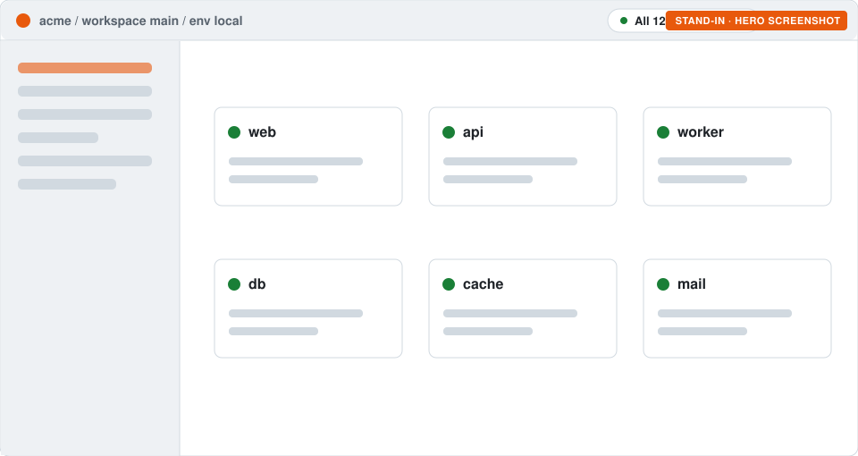
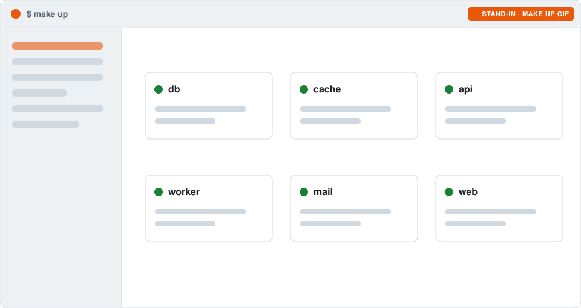
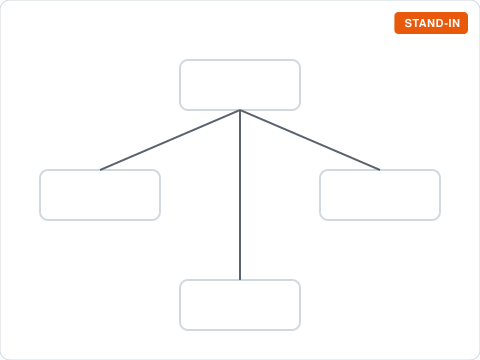
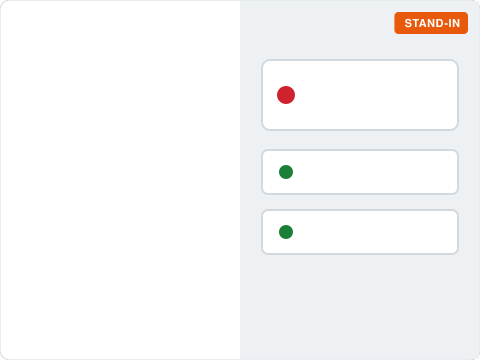
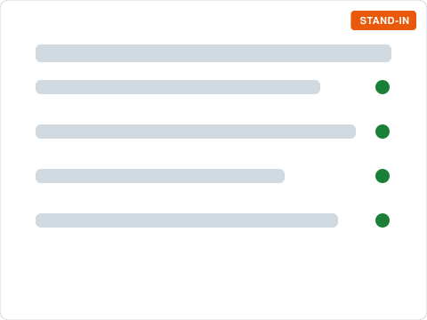

<p align="center">
  
</p>
<h1 align="center">Den</h1>
<p align="center"><b>Your whole stack, up and green, in one place. Built so you and your agents work by the same rules.</b></p>
<p align="center">
  <a href="https://www.npmjs.com/package/@monster-orange/den"></a>
  
  <a href="https://github.com/Monster-Orange/den/actions/workflows/ci.yml"></a>
</p>

<picture>
  <source media="(prefers-color-scheme: dark)" srcset="docs/images/preview/hero-dark.svg">
  
</picture>

## What Den is

Den is an opinionated local development framework for solo developers and small teams. You point it at the
repos you work on. Den starts them in the right order, puts them behind a local HTTPS edge, and shows you the
whole thing in one web shell and one CLI: what's up, what's down, why, and the fix.

It doesn't replace your tools. Your repos, Docker, your test runners, your secrets store and your agents stay
yours. Den connects them and turns on good practice from the start.

<p align="center">
  
</p>

## How it helps

- **"How do I run this?" goes away.** Each repo declares how it starts, what it needs and how to check it's
  healthy. Den works out the order and brings everything up, the same way on every machine.
- **One place to look.** Health, logs, runs, routes and certificates for every service, in one shell, instead
  of eight terminals and a wiki page.
- **Real HTTPS locally.** Every service gets a proper hostname behind a local edge. Cookies, OAuth redirects and
  CORS behave as they do in production.
- **Tests are part of the loop.** Smoke, browser, API, user journeys, security and performance suites run against
  the environments you declare.
- **Agents work by the same rules as you.** Den exposes your stack to coding agents over MCP with the same guards
  and audit trail as a person. Agents can read and investigate. Acting is opt-in.
- **Opinionated, not locked in.** Good defaults are switched on, and almost everything can be switched off. The
  safety guards stay on. Den never needs our accounts, secrets or certificates. Everything specific to you
  lives in your own repo.

<p align="center">
  
  
  
</p>

## Get started

You need Node 22.13 or later, and Docker for anything that runs in containers. mkcert is only needed if you want local HTTPS.

```sh
npx @monster-orange/den create acme     # your own Den, named after your product
cd acme && npm install
./bin/acme register ../shop-api          # add a repo (repeat for each one)
./bin/acme up                            # start everything, in order
./bin/acme web                           # open the shell
```

That's it: `acme` is now your tool, with your name, your CLI and your config, in a repo you own.
[Step by step →](docs/reference.md#make-it-your-own)

## How it fits together

<p align="center"></p>

- **Den** is the engine, from npm. It knows nothing about your company.
- **Your distribution** (`acme`) is a small repo you own. It holds your product name, brand, environments,
  hosts and secrets setup.
- **Workspaces** group the repos you work on together. **Manifests** in each repo say how its services start,
  connect and get checked.

## Coming next

Agent sessions that survive restarts, ready-made agent roles (planner, developers, reviewer), several orgs in
one Den, and a one-command machine setup.

## Docs

[Reference](docs/reference.md) (configuration, manifests, strategies, CLI) · [Distributions](docs/distributions.md) ·
[Changelog](CHANGELOG.md)

Found a bug or have an idea? [Open an issue](https://github.com/Monster-Orange/den/issues/new).

MIT licence.
