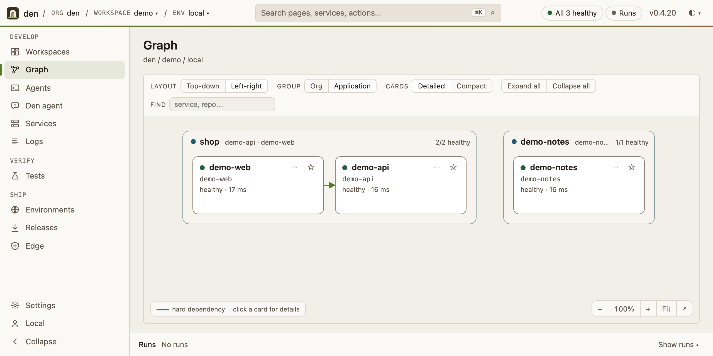
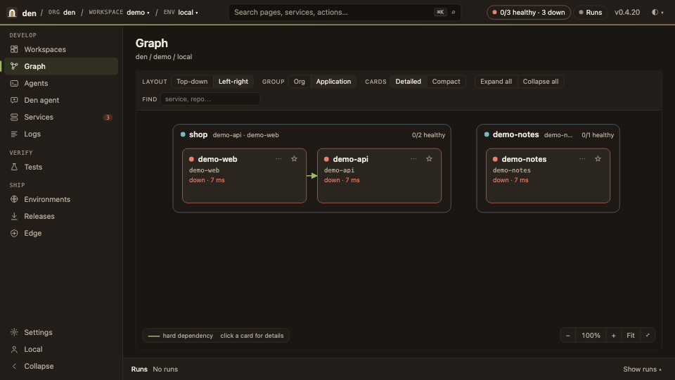
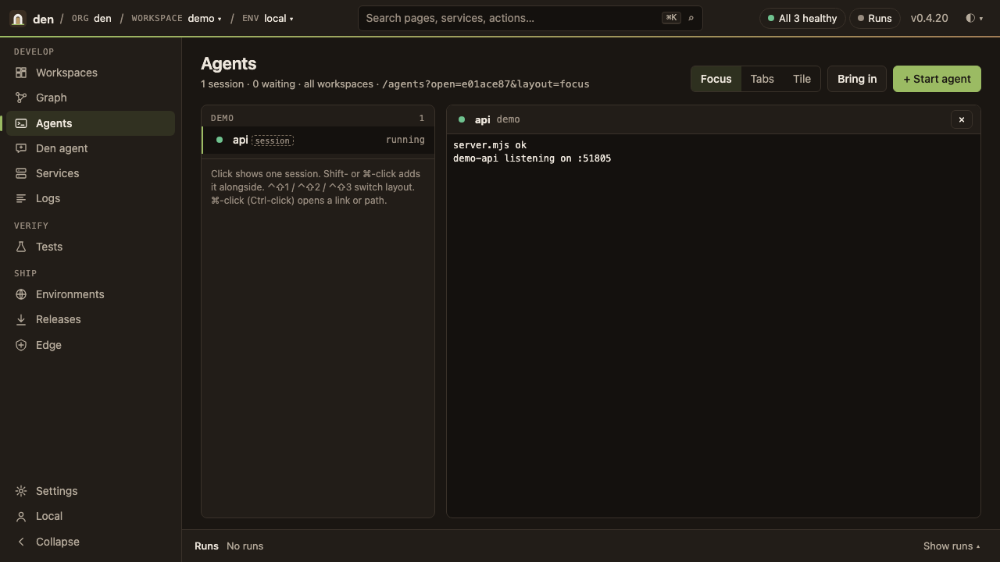
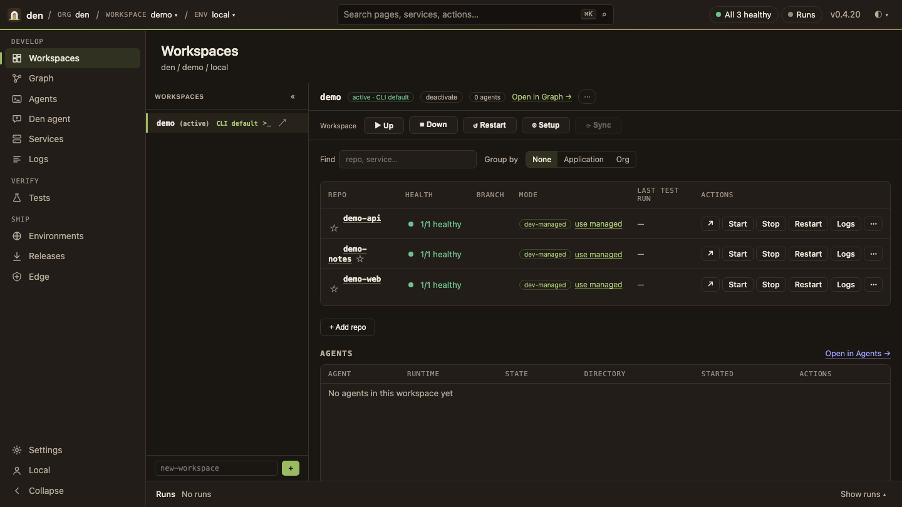
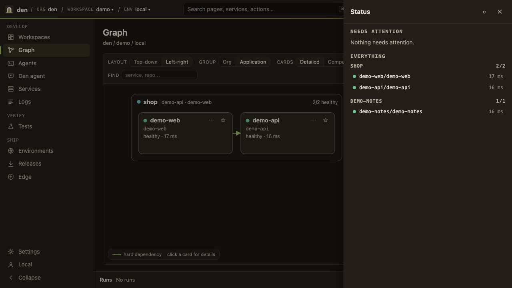
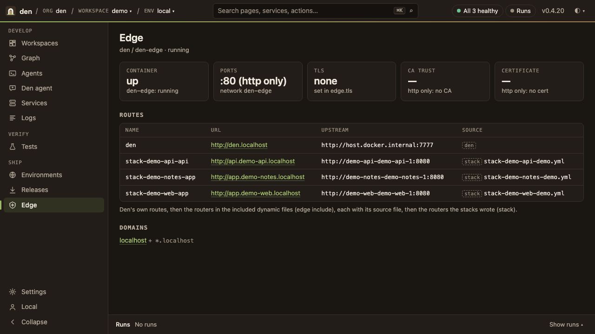
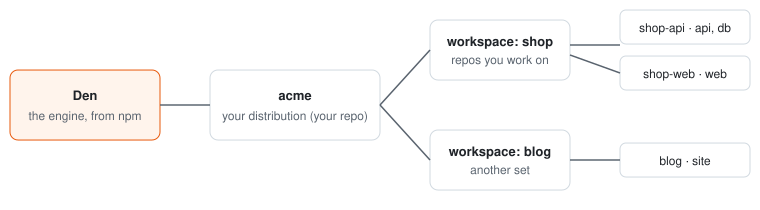

<p align="center">
  
</p>
<h1 align="center">Den</h1>
<p align="center"><b>Your whole stack, up and green, in one place. Built so you and your agents work by the same rules.</b></p>
<p align="center">
  <a href="https://www.npmjs.com/package/@monster-orange/den"></a>
  
  <a href="https://github.com/Monster-Orange/den/actions/workflows/ci.yml"></a>
</p>

<picture>
  <source media="(prefers-color-scheme: dark)" srcset="docs/images/0.4.20/hero-dark.png">
  
</picture>

## Set up by your agent

Paste this line into your coding agent (Claude Code, Codex, Gemini, Grok, …):

```text
Set up Den for me by following https://raw.githubusercontent.com/Monster-Orange/den/main/skills/install-den/SKILL.md
```

The agent follows the [install-den skill](skills/install-den/SKILL.md). It checks Node and git, installs Den,
asks you its name and folder, starts it, and hands you a one-time link. Open it: your Den's own agent takes it
from there. That agent finds your repos, adds them without changing them and starts one, and each change waits
for you to allow it in the browser. Neither agent asks for a password in chat, edits your repos or sends anything
off your machine. Every step answers in JSON and is safe to re-run: see
[Set up by your agent](docs/distributions.md#set-up-by-your-agent) and [The server agent](docs/distributions.md#the-server-agent).

## What Den is

Den is an opinionated local development framework for solo developers and small teams. You point it at the
repos you work on. Den starts them in the right order, puts them behind a local edge, and shows you the
whole thing in one web shell and one CLI: what's up, what's down, why, and the fix.

It doesn't replace your tools. Your repos, Docker, your test runners, your secrets store and your agents stay
yours. Den connects them and turns on good practice from the start.

<p align="center">
  
</p>

## How it helps

- **"How do I run this?" goes away.** Each repo declares how it starts, what it needs and how to check it's
  healthy. Den works out the order and brings everything up, the same way on every machine.
- **One place to look.** Health, logs, runs, routes and certificates for every service, in one shell, instead
  of eight terminals and a wiki page.
- **Real hostnames locally.** Every service gets a proper hostname behind a local edge, over HTTPS when you
  turn it on (a local CA with mkcert, or certificates you bring). Cookies, OAuth redirects and CORS behave as
  they do in production.
- **Several workspaces at once.** Keep feature branches side by side as workspaces. Health covers every active
  one, and `up`, `down`, `restart` and `setup` take `-w <workspace>`, or find the service you name across them.
- **Tests are part of the loop.** Smoke, browser, API, user journeys, security and performance suites run against
  the environments you declare.
- **Agents work by the same rules as you.** Start an agent from a persona (planner, orchestrator, developers,
  devops, reviewer, UX designer, or your own) in a workspace. Its terminal opens in the Agents tab and keeps
  running when you close the page or restart the web server. Over MCP it sees your stack with the same guards
  and audit trail as a person, under a token of its own. Agents can read and investigate, and acting is opt-in.
  Starting an agent never asks for your admin password: Den asks for it only when a command it runs needs sudo.
- **Safe on localhost, signed in beyond it.** On localhost there is nothing to sign in to. Reached through the
  edge from another machine, or over your network, every page and call needs a sign-in, and there is no password:
  Sign in with GitHub as the Den's owner, approve the computer with a code (`acme web approve <code>`), or open a
  one-time link from `acme web login`.
- **Opinionated, not locked in.** Good defaults are switched on, and almost everything can be switched off. The
  safety guards stay on. Den never needs our accounts, secrets or certificates. Everything specific to you
  lives in your own repo.

<p align="center">
  
  
  
  
</p>

## Get started

You need Node 22.13 or later, and Docker for anything that runs in containers. mkcert is only needed if you want Den to issue local HTTPS certificates.

```sh
npx @monster-orange/den@latest create acme     # your own Den, named after your product
cd acme && npm install
./bin/acme register ../shop-api          # add a repo (repeat for each one)
./bin/acme up                            # start everything, in order
./bin/acme web                           # open the shell
```

That's it: `acme` is now your tool, with your name, your CLI and your config, in a repo you own.
[Step by step →](docs/reference.md#make-it-your-own)

## How it fits together

<p align="center"></p>

- **Den** is the engine, from npm. It knows nothing about your company.
- **Your distribution** (`acme`) is a small repo you own. It holds your product name, brand, environments,
  hosts and secrets setup.
- **Workspaces** group the repos you work on together. **Manifests** in each repo say how its services start,
  connect and get checked.

## Coming next

One workspace focus with Switch, agent pane layouts, and a Start dialog with personas, roles and a choice of
runtime and model.

## Docs

[Reference](docs/reference.md) (configuration, manifests, strategies, CLI) · [Distributions](docs/distributions.md) ·
[Changelog](CHANGELOG.md)

Found a bug or have an idea? [Open an issue](https://github.com/Monster-Orange/den/issues/new).

MIT licence.
